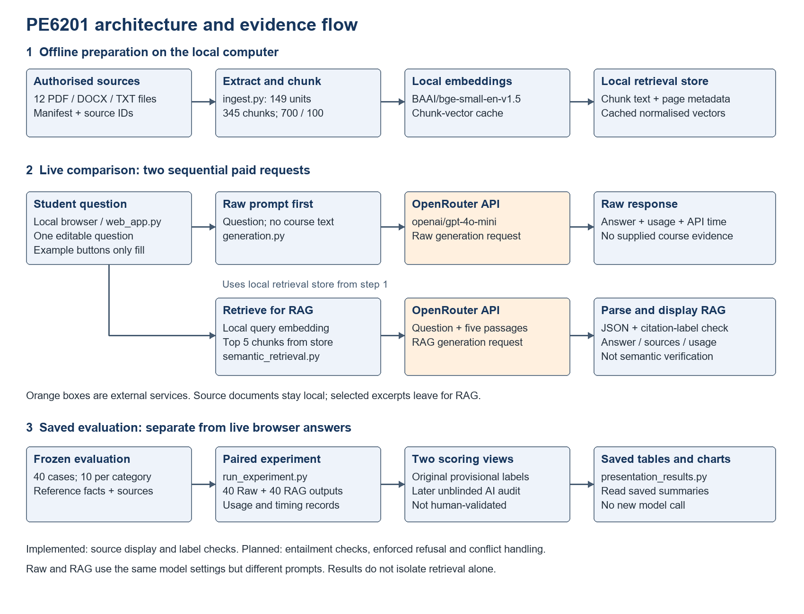
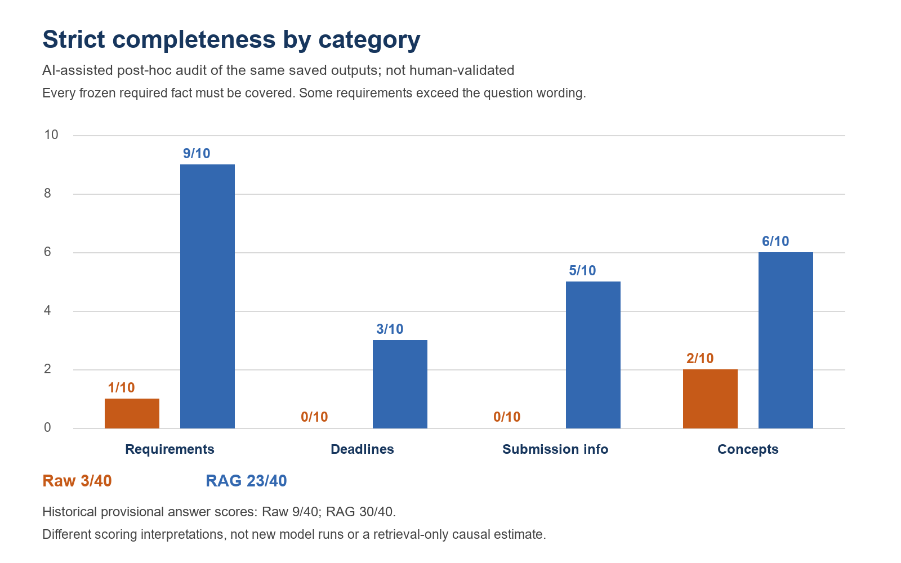

# PE6201 — Course-Grounded AI Assistant

**Jiang Dong | Individual End-of-Course Project | Public review edition**

This repository is public: the instructor can read its code and documentation without an invitation or a GitHub account. It is a reviewable code repository, **not a hosted live chatbot**. The full report and face-and-screen demo are provided as LMS attachments, along with the restricted reproduction data.

## Start here for marking

| Item | Public location |
|---|---|
| Persona, inputs/outputs, target and achieved metrics | [Product documentation](docs/PRODUCT.md) |
| Architecture | Diagram below |
| Data scope and files withheld from public distribution | [Data explanation](docs/DATA.md) |
| Evaluation design, results and critique | [Evaluation explanation](docs/EVALUATION.md) |
| Code responsibilities | [Module map](docs/MODULES.md) and [source code](src/) |
| Run and reproduce | [Run instructions](docs/RUN_MARKER.md) |
| Formal report, video, complete evidence | LMS submission attachments; no private GitHub access needed |



## What the project does

A local browser lets a student freely ask course questions and compare a foundation model without course documents (Raw) against the same model with retrieved evidence (RAG). The prototype displays answers, source labels and API usage. It uses `openai/gpt-4o-mini` through OpenRouter and local `BAAI/bge-small-en-v1.5` retrieval. It does not replace official course announcements.

## Results at a glance

40 questions, ten per category, and 80 saved answers. Both scoring interpretations refer to the **same** answers.

| Measure | Raw | RAG |
|---|---:|---:|
| Historical provisional answer score | 9/40 | 30/40 |
| Post-hoc strict completeness | 3/40 | 23/40 |
| Post-hoc page-citation support | 0/40 | 29/40 |
| Strict complete AND page-supported | 0/40 | 22/40 |
| Generation API cost / 1,000 questions | $0.0513 | $0.1984 |
| Mean API request time | 1.543 s | 1.503 s |

The later review is **AI-assisted, unblinded, post-hoc and not human-validated**. Different prompts prevent a retrieval-only causal conclusion. Some required facts exceed the natural-language question. Cost excludes embeddings/hosting/review; time excludes retrieval/browser overhead. No speed advantage is established. Prices describe the historical experiment, not current pricing.



## Quick start: saved-results page without private data or paid requests

Use Python **3.11+** (tested locally with 3.12).

```powershell
python -m venv .venv
.\.venv\Scripts\Activate.ps1
python -m pip install -r requirements.txt
python src/web_app.py --project . --port 8765
```

Open http://127.0.0.1:8765/. The saved aggregate tables and charts work without a key or private corpus. A missing-key/data status is expected. **Do not click Compare** in this public-only setup; live course answering requires the LMS data package, your own key, and permission to send excerpts. Dependency installation needs internet. The application remains local; GitHub does not run it.

## Publication boundary

This is a fresh repository with no imported private Git history. No course originals, teacher email, chunks/embeddings, original test questions/reference facts, per-question answers or handwritten case-specific scoring notes are published here. Aggregate results are unchanged. The legacy `apply_human_review.py` contains case-specific notes and is supplied only in the LMS CODE package; its name never certified human review. The remaining implementation files are copied unchanged from the reviewed submission.

The instructor can reproduce the complete project using **both LMS ZIP attachments**, without joining any private repository. See [exact reproduction steps](docs/RUN_MARKER.md). Public-only offline evidence checks intentionally cannot pass without the withheld records; no synthetic substitute is presented as the original experiment.

AI assistance was used in implementation, evaluation preparation, scoring and writing. The prototype is not production hardened. No API keys are supplied. Do not upload restricted materials or secrets to this public repository.
